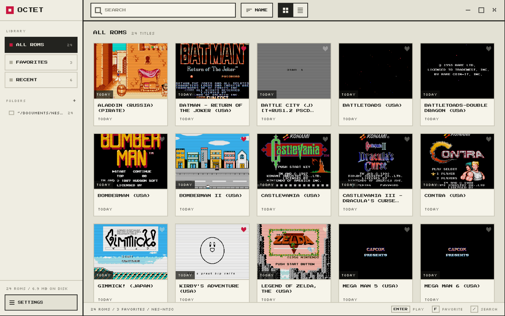
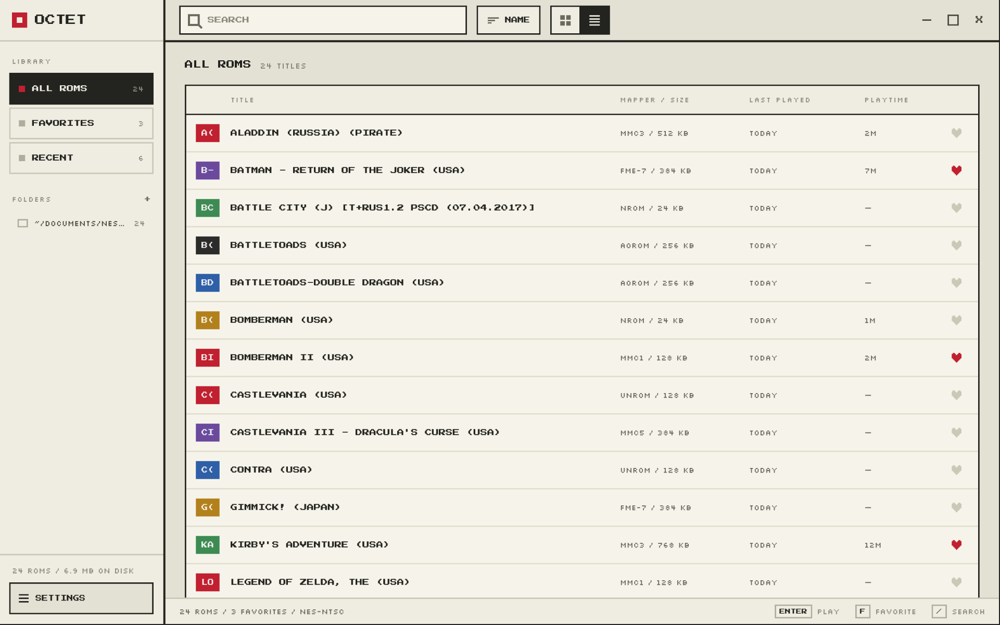
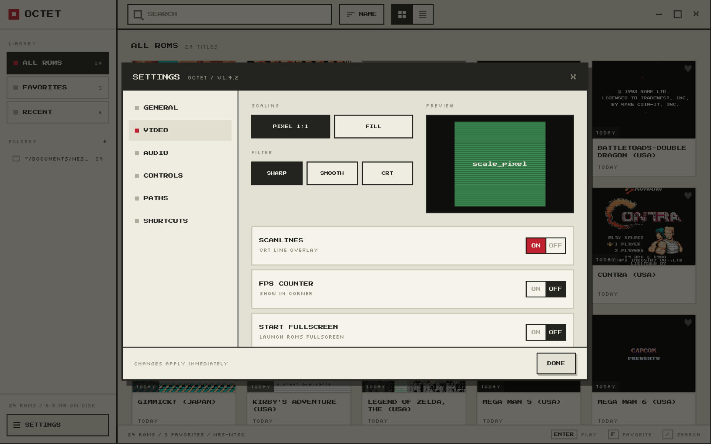

# Octet Desktop

A NES emulator for the desktop. Rust core in a Tauri shell, React interface,
and the same pixel-art design
[octet-android](https://github.com/sky9t-sulia/octet-android) wears.

|                                         Library                                          |                                              As a table                                               |                              Settings                              |
|:----------------------------------------------------------------------------------------:|:-----------------------------------------------------------------------------------------------------:|:------------------------------------------------------------------:|
|  |  |  |

## What it does

- Plays NES cartridges from folders you point it at — searched, sorted,
  favourite, as cards or as a table, with playtime kept per game and a frame
  from the game itself as each card's art.
- Every mapper the core supports, NROM and MMC1 through MMC5 and the VRCs —
  [octet-emu](https://github.com/sky9t-sulia/octet-emu) has the list.
- Eight save-state slots per cartridge, each carrying the frame it was taken
  on, plus battery saves for the cartridges that have them.
- Keyboard or gamepad, both rebindable, and every shortcut listed in settings.
- CRT filter with scanlines and colour bleed, the same shader the phone uses.
  Integer or fractional scaling, always in proportion.
- Watches your ROM folders and picks up files as they appear.
- Light/dark themes, 11 languages.

## ROMs

None are included, and none are downloaded. Octet plays game files you supply
from a folder on your machine — whether a cartridge was yours to copy is yours
to answer for.

## Building

The emulator core lives in [octet-emu](https://github.com/sky9t-sulia/octet-emu),
so clone it beside this repository. Then:

    npm install
    npm run tauri dev

On Fedora the shell needs these once:

    sudo dnf install webkit2gtk4.1-devel libsoup3-devel gtk3-devel \
                     dbus-devel librsvg2-devel openssl-devel

## License

MIT.
